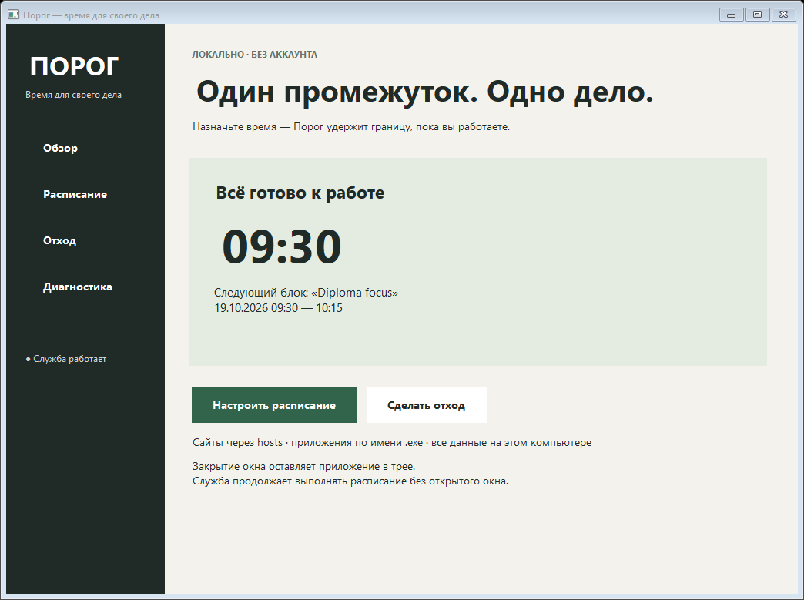

# Порог

Локальный блокировщик отвлекающих сайтов и приложений для Windows. Задайте рабочие промежутки: Порог применит ограничения по расписанию и снимет их в конце. «Отход» на 3–12 минут поможет сделать перерыв вне экрана.

**Состояние:** MVP, кандидат для испытаний. Успешны сборка, 64 теста ядра на macOS/Linux/Windows и интеграция настоящей Windows-службы. Доказательства — в [протоколе приёмки](docs/ACCEPTANCE.md). Пользовательские Windows 10/11 и подпись кода проверяются отдельно.



## Три функции MVP

1. Блокировка явно заданных доменов через `hosts` и завершение выбранных `.exe` во время промежутка. Прямой IPC также запрещает изменение активного блока.
2. Расписание с датами, несколькими промежутками, отдельными целями и намерением. Предупреждение за 60 секунд, время окончания и обратный отсчёт.
3. «Отход» на 3–12 минут: полноэкранное окно на каждом мониторе, повторный захват фокуса, абсолютный срок окончания в службе, без кнопки пропуска.

Аккаунтов, серверов, аналитики и платёжных API нет. Данные остаются на компьютере. Интерфейс работает без прав администратора; установка службы требует повышения прав.

## Установка на Windows

Целевые платформы: Windows 10 22H2 / Windows 11 x64. Проверка на Windows runner не заменяет испытания на этих клиентских версиях.

1. Скачайте готовый [Porog-win-x64 из проверенного запуска Actions](https://github.com/xylonnnnnn/Porog/actions/runs/39228874422/artifacts/12176386932). Распакуйте архив артефакта, затем вложенный `Porog-win-x64.zip` в отдельную папку. Последующие сборки находятся в [Actions](https://github.com/xylonnnnnn/Porog/actions); предварительные релизы по тегу — в [Releases](https://github.com/xylonnnnnn/Porog/releases).
2. Откройте PowerShell **от имени администратора** в папке архива.
3. Выполните `./scripts/Install.ps1`. Служба и автозапуск интерфейса будут зарегистрированы; Порог появится в меню «Пуск» и в трее.

В архив включена среда .NET; отдельно устанавливать её для запуска не требуется. Если политика PowerShell запрещает локальные сценарии, ознакомьтесь с [руководством](docs/USER_GUIDE.md#политика-powershell). Не отключайте SmartScreen или антивирус для установки.

**Если повышение выполняется под другой учётной записью**, заранее получите SID обычного пользователя командой `whoami /user`, затем передайте `-OwnerSid S-1-5-21-...` установщику. Установка рассчитана на одного владельца Windows.

## Сборка из исходников

Нужен .NET SDK 10.0.100 или новее в ветке 10.0; версия задаётся `global.json`.

```powershell
dotnet restore Porog.sln --locked-mode
dotnet build Porog.sln -c Release --no-restore
dotnet test tests/Porog.Core.Tests -c Release --no-build
./scripts/Build.ps1
```

Результат: `artifacts/Porog-win-x64.zip`. Сборка Windows-компонентов возможна на macOS/Linux благодаря `EnableWindowsTargeting`; их запуск требует Windows. Тесты ядра выполняются на macOS, Linux и Windows.

Для Windows smoke-теста на **выделенной тестовой машине** запустите от администратора:

```powershell
dotnet publish tests/Porog.TestTarget -c Release -r win-x64 --self-contained false -o artifacts/test-target
./scripts/Test-Windows.ps1
```

Проверка устанавливает и удаляет службу, временно добавляет `porog-smoke.invalid` в `hosts`, завершает собственный `Porog.TestTarget.exe`, проверяет восстановление и сохраняет шесть изображений реальных WinForms-экранов. Не предназначена для компьютера с установленным пользовательским Porog.

## Ограничения

- `hosts` блокирует только перечисленные имена. Например, `youtube.com`, `www.youtube.com` и `m.youtube.com` — три отдельные записи. Wildcard и блокировка всего браузера не поддерживаются.
- Secure DNS / DoH, собственный DNS приложения, VPN, уже открытые соединения и кэш браузера могут обходить блокировку. Обновление DNS-кэша при активации не гарантируется.
- Служба проверяет процессы раз в секунду и завершает только процессы владельца установки. Это может привести к потере несохранённых данных в выбранном приложении. Счётчик учитывает успешные завершения процессов, а не посещения сайтов.
- «Отход» требует работающего UI. Системные сочетания клавиш, диспетчер задач, другой пользователь, остановка службы и перезагрузка могут обходить ограничения. После старта службы текущий интервал возобновляется.
- Служба работает как LocalSystem ради системного `hosts` и контроля процессов; обычному пользователю недоступна запись её файлов. IPC ограничен SID владельца. Полной защиты от администратора нет.
- Сборка не подписана сертификатом; совместимость со SmartScreen и антивирусами должна быть проверена перед распространением.

## Документация

| Документ | Содержание |
|---|---|
| [Руководство пользователя](docs/USER_GUIDE.md) | Установка, сценарии, диагностика, удаление |
| [Архитектура](docs/ARCHITECTURE.md) | Компоненты, данные, время, ACL, принятые решения |
| [Контракт IPC](docs/IPC.md) | Шесть команд, JSON, ошибки, повторы |
| [Приёмка](docs/ACCEPTANCE.md) | T-01–T-14, FR-01–FR-14, доказательства и непроверенные условия |
| [Отчёт](docs/REPORT.md) | Постановка задачи, реализация, проверки, ограничения |
| [Отчёт Word](docs/Отчёт_Порог.docx) | Оформленный отчёт для передачи |
| [Исходное ТЗ](Porog_MVP.docx) | Предоставленная спецификация MVP |
| [Исходный чек-лист](Чек-лист%20—%20Порог.docx) | Бизнес-гипотеза и границы продукта |

## Структура

```text
src/Porog.Core         модели, валидация, планировщик, хранилище, hosts, контроллер
src/Porog.Service      Windows Service, процессы, защищённый named pipe
src/Porog.Desktop      WinForms, трей, расписание, полноэкранный перерыв
tests/Porog.Core.Tests автоматические проверки с управляемым временем
tests/Porog.TestTarget безопасный процесс для Windows-интеграции
scripts               сборка, установка, удаление, восстановление, smoke-тест
docs                  отчёт, архитектура, контракт и руководства
.github/workflows      тесты Linux/Windows, установочный архив, prerelease по тегу v*
```
