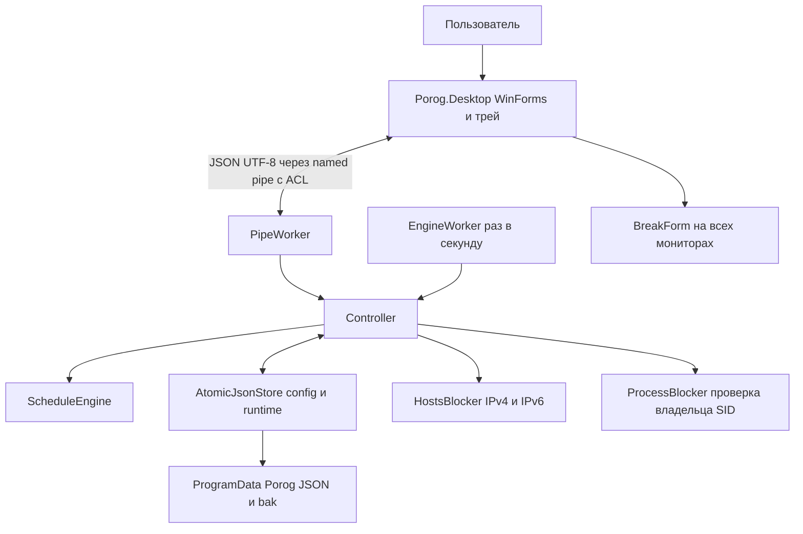
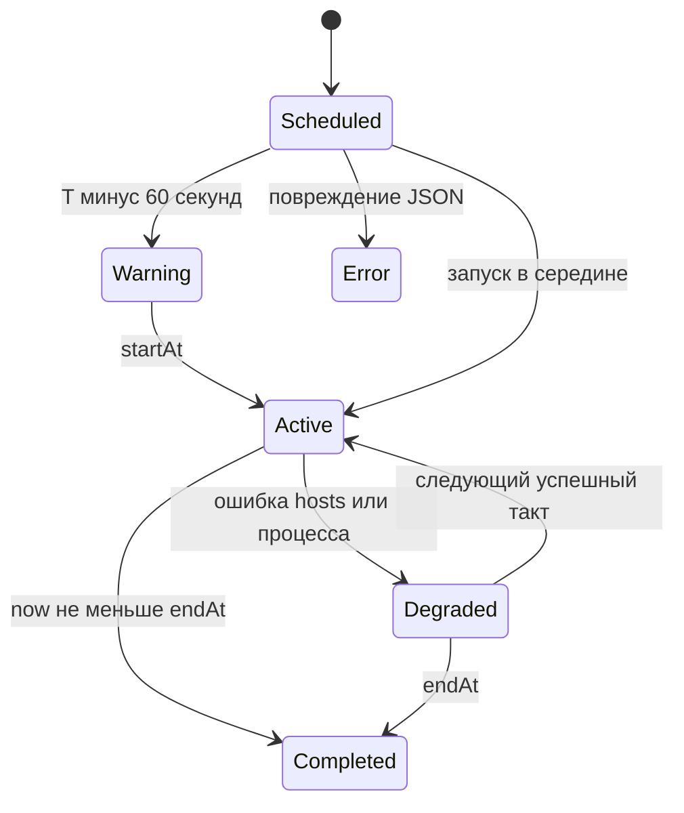

# Архитектура Порог

## Компоненты

`Porog.Core` не зависит от Windows и содержит модель, валидацию, конечные состояния, хранилище и транзакцию hosts. `Controller` — единственная точка записи. Его блокировка `gate` сериализует команды и такты службы, поэтому сохранение и начало интервала не расходятся.

`Porog.Service` — Generic Host с `AddWindowsService`, `EngineWorker` и `PipeWorker`. `Porog.Desktop` — независимый обычный процесс WinForms, который не правит `hosts` и `config.json`. Статус опрашивается раз в секунду, IPC имеет таймаут 2 секунды.

## Решения по открытым вопросам ТЗ

| Вопрос | Решение MVP |
|---|---|
| Версии Windows | Целевые Windows 10 22H2 и Windows 11 x64; клиентская матрица требует ручных испытаний |
| Пересечения | Отклоняются для включённых промежутков; соседние `[start,end)` разрешены |
| Время | `DateTimeOffset`, сравнение абсолютного времени; в UI местное время; неоднозначное время DST отклоняется |
| Перезапуск | Активный промежуток возобновляется; полностью пропущенный не воспроизводится |
| Поддомены | Только явно перечисленные имена; без wildcard и неявного расширения |
| Права службы | LocalSystem для системного hosts и токенов процессов; это осознанный компромисс MVP |
| Многопользовательский режим | Один SID владельца установки; глобальные сайты hosts действуют на весь компьютер |
| Счётчик | Только успешные завершения процессов владельца; посещения сайтов неизвестны |
| Автозапуск | Автоматическая служба, обычный UI через задачу входа владельца |
| Оплата | Не входит в три функции MVP; платёжные API и тарифные ограничения не реализованы |
| Активные правки | Защищена вся начатая запись, включая имя и цели; будущие записи редактируются |
| Белые списки | Вне MVP; нормализованные индивидуальные цели в каждом промежутке |

## Данные и надёжность

`config.json`: `schemaVersion`, `appId`, `configVersion`, `schedules[]`, `settings`, `updatedAt`. `Schedule` содержит UUID, название, включённость, начало и конец со смещением, массивы доменов и процессов, строку намерения.

`runtime.json`: версия схемы, ключи принятых предупреждений, рабочая сессия, «Отход» и последняя завершённая сессия. Сессия содержит UUID, связь с расписанием, режим, абсолютные сроки и число завершений процессов. История всех событий не ведётся.

`owner.json`: SID владельца, создаваемый администратором. Секретов нет. Доступ: SYSTEM и Administrators — полный, владелец — чтение. Программные файлы имеют аналогичную ACL. Данные не передаются в сеть.

JSON сохраняется во временный файл в том же каталоге с `Flush(true)`, затем заменяется через `File.Replace`; предыдущая версия становится `.bak`. Повреждённый JSON и неизвестная схема не замещаются молча. Пропавший основной файл при существующей `.bak` также означает ошибку. Первая запись создаёт только основной файл. Настройки восстанавливаются отдельным действием администратора.

Ключ предупреждения включает ID, начало и окончание. Служба сохраняет решение о предупреждении до выдачи статуса; UI хранит локальную отметку доставки в `%LocalAppData%\Porog\notifications.txt`. ОС может подавить уведомление; гарантия фактического показа пользователю отсутствует.

## Блокировки

`HostsBlocker` читает байты с запретом параллельной записи, проверяет маркеры, заменяет только свой блок, добавляет `0.0.0.0 domain` и `:: domain`. Побайтовое представление внешней части, BOM и комментарии сохраняются. Если исходный файл не имеет последнего перевода строки, добавляется разделитель; при снятии он остаётся. Перед изменением создаётся `.porog.bak`, которая не используется для полной автоматической перезаписи hosts. В случае исключения записи выполняется попытка вернуть прочитанные байты; выключение питания в середине записи не имеет абсолютной гарантии атомарности.

Проверка повторяется каждый такт и восстанавливает собственный блок после допустимого внешнего редактирования. Повреждённые/повторные маркеры отклоняются. Secure DNS, кэш и открытые соединения находятся вне гарантий hosts.

`ProcessBlocker` находит совпадения по имени без регистра, читает SID токена и завершает только процессы владельца. Системные имена, браузеры целиком и Porog запрещены валидатором. Дочерние процессы не завершаются автоматически. Счётчик растёт только после подтверждённого завершения; отказ доступа даёт `PROCESS_CONTROL_FAILED`.

«Отход» — состояние службы плюс окна UI, а не замена Windows secure desktop. UI использует сохранённое абсолютное время, блокирует обычное закрытие окна, поддерживает topmost и повторную активацию. Ctrl+Alt+Del и другие системные механизмы доступны. Подключённые после старта перерыва мониторы не покрываются автоматически до перезапуска UI.

## Состояния и отказы

`Running` означает, что последний такт смог применить механизмы, но не доказывает закрытие домена во всех браузерах. `Degraded` показывает частичную защиту. `Error` останавливает изменение состояния до явного восстановления. Разрыв IPC даёт в UI «Защита не подтверждена», без сохранения зелёного статуса.

Повторные `SaveConfig` и `StartBreak` с тем же UUID и телом возвращают сохранённый ответ в пределах 256 записей процесса службы. Смена тела при повторном UUID отклоняется. «Отход» также узнаёт свой UUID после рестарта. Для `SaveConfig` после рестарта нужно читать конфигурацию и сверять версию: успешная запись могла уже произойти.

## Ссылки на выбранные API

- [Microsoft Learn — Windows Service](https://learn.microsoft.com/en-us/dotnet/core/extensions/windows-service)
- [Microsoft Learn — NamedPipeServerStreamAcl.Create](https://learn.microsoft.com/en-us/dotnet/api/system.io.pipes.namedpipeserverstreamacl.create)
- [GitHub Docs — сборка и тестирование .NET](https://docs.github.com/en/actions/tutorials/build-and-test-code/net)
