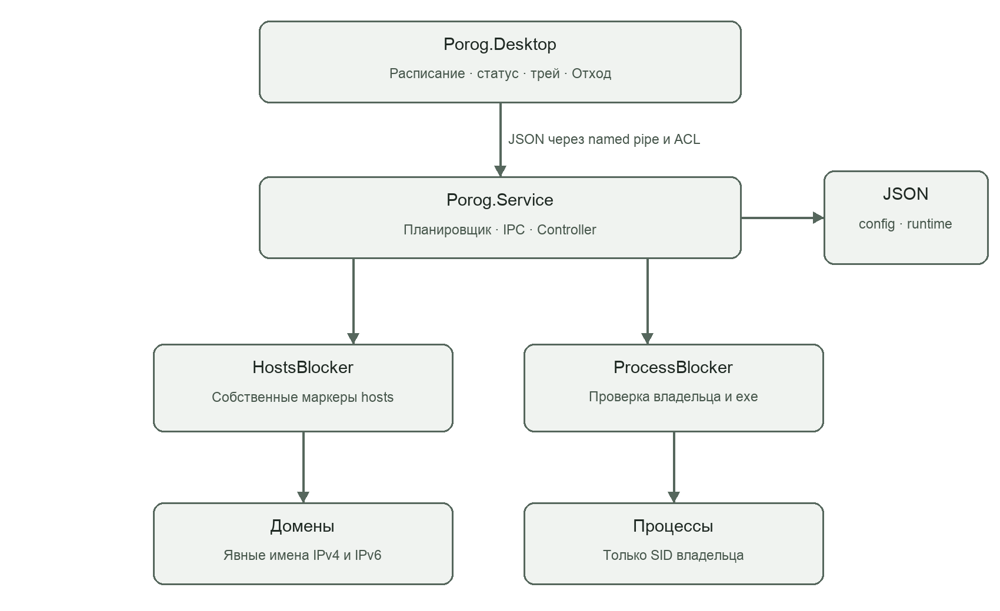

# Отчёт о реализации проекта Порог

Локальный блокировщик сайтов и приложений для Windows

Версия реализации 1.0.0. Дата подготовки 19 октября 2026 года.

## Введение

В проекте реализован MVP приложения «Порог» по двум предоставленным документам: техническому заданию `Porog_MVP.docx` от 12 октября 2026 года и бизнес-чек-листу «Порог». Результат включает исходный код Windows-приложения, фоновую службу, автоматические тесты, установочные сценарии и эксплуатационную документацию. Проект предназначен для личного компьютера; серверная инфраструктура и учётная запись не требуются.

На этапе локальной проверки все компоненты успешно собраны, а 64 автоматических теста пройдены. Испытания на реальных клиентских Windows 10/11, проверка поведения браузеров с Secure DNS и подпись программного кода выделены в отдельные условия приёмки. Компиляция Windows-кода на macOS не подменяет эти испытания.

## 1 Постановка задачи

Целевая аудитория — студенты и фрилансеры, которым нужно завершить собственный рабочий промежуток на личном компьютере Windows. В исходной гипотезе проблема описана как отсутствие границы между рабочим материалом и отвлекающими сайтами или приложениями. Указанные в чек-листе потери 5–15 часов в неделю являются гипотезой источника; проект не проводил исследование, которое подтверждало бы эту оценку.

Цель разработки — дать пользователю возможность назначить время и список отвлечений, применить ограничения в начале промежутка и автоматически снять их в конце. Короткий режим «Отход» должен помогать отойти от экрана на 3–12 минут. Во время начатого промежутка обычная отмена через интерфейс или локальную команду недоступна.

В соответствии с техническим заданием обязательный объём ограничен тремя функциями. Облачная синхронизация, родительский контроль, корпоративное администрирование, оплата и абсолютная защита от администратора не входят в MVP. Несколько самостоятельных промежутков, строка намерения и минимальный счётчик наблюдаемых завершений процессов реализованы как поддержка основного сценария, без платёжной системы и полной истории посещений.

| Функция | Состав реализации | Результат для пользователя |
|---|---|---|
| MVP-01 Блокировка | Домены через hosts, процессы по имени exe, серверный запрет активных правок | Ограничения удерживаются до срока |
| MVP-02 Расписание | Даты, несколько промежутков, цели, предупреждение за минуту | Собственный график и видимый конец |
| MVP-03 Отход | 3–12 минут, полноэкранные окна, сохранённый срок | Короткий перерыв без штатного пропуска |

## 2 Уточнение требований и принятые решения

В ТЗ оставлены открытыми правила пересечений, поддоменов, восстановления, часового пояса и прав службы. Для реализации выбрана минимальная локальная архитектура с одним владельцем установки Windows. Решения зафиксированы в документации и не требуют серверного согласования во время работы.

Включённые промежутки не пересекаются. Границы имеют вид [начало, конец): соседние интервалы допустимы, а в момент окончания старое ограничение уже не действует. Начатая запись защищена целиком: нельзя удалить её, выключить, сократить срок или заменить цели. Допускается редактирование будущих записей при сохранении текущей.

Расписание хранит время со смещением UTC. Интерфейс показывает местный часовой пояс Windows и отвергает неоднозначные или несуществующие моменты перехода времени. При запуске службы внутри промежутка ограничения восстанавливаются немедленно. Полностью прошедший при выключенном компьютере промежуток не воспроизводится задним числом.

Поддомены не расширяются автоматически: youtube.com и www.youtube.com задаются отдельно. Счётчик увеличивается только после подтверждённого завершения процесса владельца установки. Попытки посещений сайтов из hosts не наблюдаются и не заявлены как измеряемые события.

## 3 Архитектура и выбор технологий

Использованы C# и .NET 10. Интерфейс построен на Windows Forms, фоновый компонент — на Generic Host с интеграцией Windows Service. Для локального обмена выбран named pipe; внешнее HTTP API отсутствует. Данные представлены JSON, поэтому для MVP не требуется база данных.

Архитектура разделена на три проекта. Porog.Core содержит модели, валидацию, планировщик, контроллер, атомарное JSON-хранилище и механизм hosts. Porog.Service отвечает за Windows Service, защищённый IPC и проверку процессов через Windows API. Porog.Desktop содержит трей, редактор, статусы и окна «Отхода».

Контроллер сериализует такты планировщика и команды записи с помощью общей блокировки. Интерфейс не является источником истины и не изменяет конфигурацию напрямую. Даже при самостоятельном обращении к IPC служба повторно валидирует данные, проверяет версию конфигурации и защищает активный интервал.

Изоляция платформенной части позволяет запускать тесты ядра на macOS, Linux и Windows. Полная Windows-сборка выполняется с EnableWindowsTargeting. Для пользователя формируется дистрибутив win-x64 со включённой средой выполнения; предварительная установка .NET для запуска не нужна.

## 4 Модель данных и сохранность

Основные сущности соответствуют спецификации: конфигурация приложения, расписание, настройки и локальное состояние сессии. В JSON-контракте цели представлены массивами строк, как в примере SaveConfig исходного ТЗ. Флаг включения относится к промежутку, а не к каждой цели отдельно.

| Сущность | Основные поля | Правило целостности |
|---|---|---|
| AppConfig | schemaVersion, appId, configVersion, schedules, settings | Версия схемы 1, appId Porog |
| Schedule | UUID, название, начало, конец, домены, процессы, намерение | Непустое имя, начало раньше конца, хотя бы одна цель |
| Settings | breakDurationMinutes, warningSeconds | Отход 3–12, предупреждение 60 |
| Session | UUID, scheduleId, режим, сроки, attempts | Абсолютный срок, неотрицательный счётчик |
| RuntimeState | предупреждения, WorkSession, BreakSession, LastCompleted | Сохранение активных сроков и последнего результата |

JSON записывается во временный файл в том же каталоге, сбрасывается на диск и затем подменяет основной файл через File.Replace. Предыдущая успешно записанная версия сохраняется в .bak. При первом сохранении резервной копии ещё нет. Невалидная конфигурация не записывается, а повреждённый основной файл не заменяется молча резервным.

Для восстановления предусмотрен отдельный административный сценарий. Он сохраняет повреждённый оригинал с отметкой времени, возвращает выбранную копию и запускает повторную валидацию службой. Неизвестная версия схемы и исчезновение основного файла при существующей копии считаются ошибкой, а не поводом сбросить настройки.

## 5 Реализация блокировок и планировщика

Планировщик раз в секунду сравнивает текущее абсолютное время с включёнными промежутками. За 60 секунд до начала он сохраняет ключ предупреждения, включающий UUID, начало и конец. После перезапуска этот ключ не создаётся заново для того же события. UI хранит отметки уже показанных уведомлений отдельно; фактический показ зависит от настроек уведомлений Windows.

Механизм сайтов добавляет в hosts собственный блок с маркерами BEGIN POROG V1 и END POROG V1. Для каждого явно указанного домена создаются записи IPv4 и IPv6. При окончании удаляется только этот блок. Чужие комментарии, кодировка внешних байтов и добавленные сторонней программой строки сохраняются. Повторные или повреждённые маркеры приводят к ошибке и ручной проверке.

Перед записью создаётся диагностическая копия hosts.porog.bak. Она не применяется автоматически целиком, поскольку это могло бы уничтожить более поздние чужие правки. Запись выполняется с запретом параллельного писателя и попыткой отката при исключении. При аварийном отключении питания абсолютная атомарность изменения системного hosts не гарантируется.

Механизм приложений получает процессы по имени исполняемого файла без учёта регистра, проверяет SID владельца токена и завершает только совпадающие процессы пользователя установки. Системные имена, браузеры целиком и собственные компоненты Porog запрещены. Проверка повторяется во время интервала; дочерние процессы не завершаются автоматически. Отказ доступа отображается как частичная защита.

«Отход» хранится службой как отдельная сессия с абсолютным временем окончания. UI создаёт полноэкранное окно на каждом текущем мониторе, скрывает обычную рамку, удерживает topmost и повторно активирует окно. Кнопки пропуска нет. Системные сочетания Windows и secure desktop не перехватываются. При остановке UI полноэкранная защита отсутствует до его перезапуска.

## 6 Интерфейс и пользовательские сценарии

Интерфейс русскоязычный. Постоянная навигация включает «Обзор», «Расписание», «Отход» и «Диагностика». Для рабочего окна выбраны спокойный светлый фон, тёмная боковая панель и зелёный акцент; предупреждения выделены отдельным цветом. Окно закрывается в трей, а служба продолжает работу независимо от видимости интерфейса.

На экране обзора отображаются ближайший промежуток либо активный блок с надписью «Закрыто до HH:MM», обратным отсчётом и доступным счётчиком. Если служба недоступна, прежний успешный статус сбрасывается. Частичная защита сопровождается конкретной ошибкой, а не общим зелёным индикатором.

Редактор принимает название, намерение, даты и время, домены и имена exe. Локальная валидация помогает исправить поля до запроса к службе; служба проверяет всё повторно. Некорректные домены, повторяющиеся цели, пересечения и обратный порядок времени отклоняются без изменения прежнего файла.

| Экран | Основной сценарий | Обработка ошибки |
|---|---|---|
| Обзор | Узнать начало или окончание блока | Потеря связи показывает неподтверждённую защиту |
| Расписание | Создать несколько промежутков и списки целей | Сообщение валидации или конфликт версии |
| Отход | Выбрать 3–12 минут и начать перерыв | Служба отклоняет второй активный перерыв |
| Диагностика | Проверить доступность механизмов | Коды и описание конкретного отказа |

Для воспроизводимого просмотра предусмотрен режим --capture-docs. Он сохраняет шесть изображений реальных WinForms-экранов на Windows, включая отдельно отрисованную форму перерыва, и не запускает новую сессию «Отхода». Это инструмент документации, а не альтернативный режим блокировки.

## 7 IPC и безопасность

Контракт содержит шесть команд: GetStatus, GetConfig, SaveConfig, StartBreak, GetSession и GetDiagnostics. Сообщения JSON UTF-8 заканчиваются переводом строки. Каждый запрос имеет UUID; успешный ответ содержит payload, ошибка — код, сообщение, детали и признак возможности повторения. Размер запроса ограничен, соединение имеет таймаут две секунды.

Named pipe доступен только владельцу установки и SYSTEM. Служба дополнительно сверяет действительный SID клиента через impersonation; идентификатор из JSON не используется для авторизации. Каталоги программы и данных защищены ACL: полный доступ имеют SYSTEM и Administrators, обычный владелец может читать, но не менять исполняемые файлы и активное состояние.

В пределах работающей службы одинаковые UUID и тело изменения возвращают прежний ответ из ограниченного кэша. Повторное использование UUID для другого тела отклоняется. Для «Отхода» UUID сохраняется как sessionId и распознаётся после рестарта. После потери ответа SaveConfig клиент читает конфигурацию и сверяет версию, поскольку запись могла уже завершиться.

Служба работает как LocalSystem: изменение системного hosts и контроль токенов требуют привилегий. Это компромисс MVP, а не утверждение о минимально возможном наборе Windows-привилегий. Переход к отдельному привилегированному посреднику можно рассматривать после целевой проверки. Проект не защищает от администратора, ручной остановки службы или изменения часов ОС.

## 8 Проверка реализации

Локальная проверка проведена 19 октября 2026 года на macOS arm64 с .NET SDK 10.0.402. Все проекты собраны в Release без ошибок и предупреждений. Набор Porog.Core.Tests включает 64 успешных тестовых случая, без пропусков и неуспешных результатов. Результат первого запуска сохранён в TRX; тесты не изменяли системный hosts компьютера разработчика.

Проверки охватывают нормализацию IDNA, отклонение URL и внедрённых строк, запрещённые процессы, граничные значения перерыва, пересечения и соседние интервалы, защиту активной записи, абсолютное время, предупреждения, сохранность hosts и повреждение маркеров. Отдельно проверены JSON, конфликт версии, идемпотентность, отказ доступа, восстановление рабочей сессии и срока «Отхода».

| Группа | Подтверждённый результат | Ограничение доказательства |
|---|---|---|
| Сборка | Все компоненты компилируются | Компиляция не равна запуску Windows API |
| Ядро | 64 теста пройдены | Время и часть отказов задаются тестовыми адаптерами |
| Файлы | Проверены реальные временные JSON и hosts | Системный файл рабочей машины не менялся |
| Windows smoke | Подготовлен автоматический сценарий установки и IPC | Результат удалённого запуска фиксируется в протоколе |
| Клиентская приёмка | Подготовлены сценарии T-01–T-14 | Windows 10/11 и браузеры требуют отдельного испытания |

GitHub Actions выполняет тесты ядра на Linux и Windows, затем собирает самостоятельный Windows-дистрибутив. Smoke-сценарий устанавливает настоящую службу, проверяет IPC и активацию расписания, временно добавляет безопасный домен porog-smoke.invalid, завершает собственный Porog.TestTarget.exe, проверяет восстановление после рестарта и очистку. Снимки UI и результаты сохраняются как артефакты. Релиз по тегу публикуется как предварительный.

Производительность UI, точность начала и окончания на эталонном ПК, реальное подавление уведомлений, сон Windows, несколько мониторов и DoH не объявлены проверенными только на основании модульных тестов. Для каждого такого случая в протоколе приёмки указан отдельный статус и способ проверки.

## 9 Развёртывание и эксплуатация

Сценарий Build.ps1 восстанавливает зафиксированные зависимости, собирает решение, запускает тесты и публикует Service и Desktop для win-x64 со включённым runtime. Архив содержит установку, удаление, восстановление, руководство и SHA256SUMS. Бинарные сборки не добавляются в Git; их формирует конвейер.

Install.ps1 требует администратора, копирует файлы в ProgramFiles, создаёт защищённый каталог ProgramData, регистрирует автоматическую службу и задачу входа обычного пользователя. Если повышение выполнено под другой административной учётной записью, необходимо явно передать SID владельца. Повторная установка поверх действующей службы отклоняется.

Uninstall.ps1 проверяет отсутствие активного промежутка, останавливает службу, очищает только собственные маркеры hosts и удаляет файлы программы, задачу и ярлык. Данные и резервные копии сохраняются. Для повреждённой установки предусмотрен явный административный параметр Recovery; он не доступен как штатная отмена в UI.

Остановка службы прекращает контроль процессов, но ранее записанные строки hosts могут оставаться до восстановления службы или административной очистки. Руководство описывает это поведение, резервные копии и ручную проверку повреждённых маркеров. Установочный пакет не имеет подписи кода; SmartScreen и антивирусы должны быть проверены до широкого распространения.

## 10 Ограничения и дальнейшая работа

Главное техническое ограничение сайтов — обход hosts через Secure DNS, собственный DNS приложения, кэш и уже открытые соединения. Для строгого системного контроля потребуется другая технология и отдельная оценка прав, совместимости и безопасности. В текущей реализации это ограничение прямо указано в интерфейсе и документации.

Режим «Отход» представляет собой ограничение обычного взаимодействия, а не неуязвимую блокировку Windows. Администратор, системные сочетания, перезапуск UI и перезагрузка могут его обойти. Новые мониторы после старта не получают окно автоматически. Запрет правок в приложении не равнозначен защите от владельца с административными правами.

Перед пользовательским выпуском нужны проверка Windows 10/11 x64, сценарии нескольких учётных записей, измерение предложенных NFR и испытания распространения. Следующий этап может включать отдельного привилегированного посредника, полноценную историю наблюдаемых событий, белые списки и подписание сборки. Монетизация из бизнес-гипотезы не включена в обязательные функции текущего MVP.

Исходное ТЗ оценивает разработку в 94 часа плюс 12 часов резерва. Это исходная оценка плана, а не фактический учёт трудозатрат выполненной реализации. В отчёте не приписаны проведённые исследования аудитории, экономический эффект или неисполненные испытания.

## Заключение

Разработан локальный MVP «Порог» с Windows-службой, интерфейсом в трее, расписанием блокировки доменов и процессов и режимом «Отход». Подготовлены защищённый IPC, сохранение и восстановление состояния, автоматические проверки, установочные сценарии и пакет документации. Серверного API, облачного хранения и обязательной регистрации нет.

Подтверждённый локальный результат — успешная сборка всех компонентов и 64 пройденных теста. Готовность к распространению определяется дополнительной приёмкой Windows и проверкой неподписанного установочного пакета. Разделение реализации, проверок и известных ограничений позволяет передать проект для воспроизводимого испытания без завышенных обещаний защиты.

## Список источников

1. Porog_MVP.docx. Техническое задание. Архитектура и спецификация MVP. Версия 1.0, 12 октября 2026 года. Предоставленный документ.
2. Чек-лист — Порог.docx. Бизнес-гипотеза продукта. Предоставленный документ.
3. Microsoft Learn. Create Windows Service using BackgroundService. https://learn.microsoft.com/en-us/dotnet/core/extensions/windows-service. Дата обращения 19.10.2026.
4. Microsoft Learn. NamedPipeServerStreamAcl.Create Method. https://learn.microsoft.com/en-us/dotnet/api/system.io.pipes.namedpipeserverstreamacl.create. Дата обращения 19.10.2026.
5. GitHub Docs. Building and testing .NET. https://docs.github.com/en/actions/tutorials/build-and-test-code/net. Дата обращения 19.10.2026.
6. Исходный код и протокол испытаний Porog. Репозиторий https://github.com/xylonnnnnn/Porog; docs/ACCEPTANCE.md.
